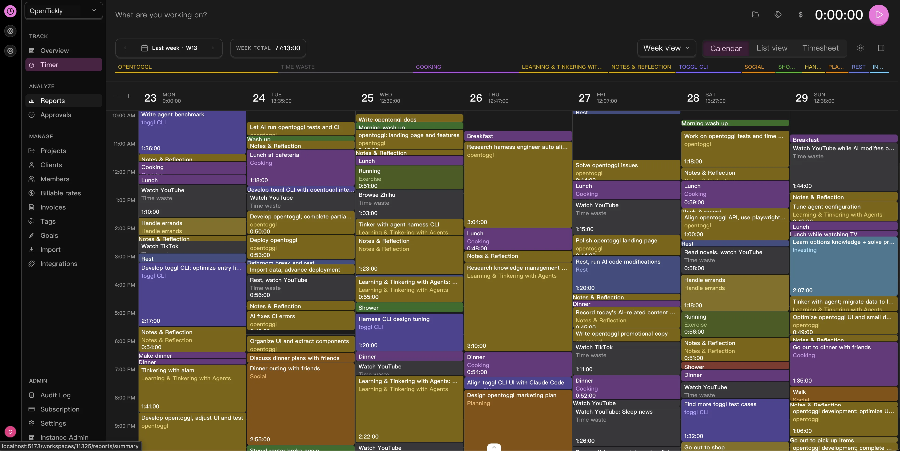

[中文](README.zh-CN.md)

<p align="center">
  
</p>

# OpenTickly

[](https://www.postgresql.org/)
[](https://docs.docker.com/compose/)
[](https://www.gnu.org/licenses/agpl-3.0)
<a href="https://hellogithub.com/repository/CorrectRoadH/OpenTickly" target="_blank"></a>

OpenTickly is a free, private-first, AI-friendly alternative to Toggl.

Toggl is a great product, but it's expensive and your data doesn't really belong to you. Its API is also limited to 30 requests per hour, which an AI agent can use up in a minute.

OpenTickly works like Toggl, so you can move your data over and back again without losing anything. Your workflows and habits stay the same. It's just cheaper, more private, and friendlier to AI.



## AI Integration

Use OpenTickly with [`toggl-cli`](https://github.com/CorrectRoadH/toggl-cli) and your AI agent can track, organize, and review your time for you. Combine it with the Lyubishchev time-tracking method to see where your day actually goes.

Read the full docs [here](https://opentoggl.com/docs/ai-integration).

## Self-Hosting

Run it with Docker Compose on your own server or NAS: CasaOS/ZimaOS, Synology, TrueNAS, Unraid, and more.

[Read the self-hosting docs](https://opentoggl.com/docs/self-hosting)

[](https://zeabur.com/templates/0272TO)

### Unraid

There's an Unraid template at `templates/opentickly.xml`. It doesn't include a database, so set up PostgreSQL and Redis containers first, then fill in `DATABASE_URL` and `REDIS_URL` in the template.

<details>
<summary>Maintainers: updating the Community Apps listing</summary>

Files: `ca_profile.xml` (repository profile), `templates/opentickly.xml` (Docker template). The icon is `apps/website/public/favicon.svg`, referenced by its raw URL.

1. `TemplateURL` must point at the raw GitHub URL of `templates/opentickly.xml`.
2. `ca_profile.xml` must stay in the repository root with a non-empty `Profile`.
3. The image in the template must match the published Docker image.
4. Validate the XML locally:

   ```sh
   xmllint --noout ca_profile.xml templates/opentickly.xml apps/website/public/favicon.svg
   ```

5. Run **Validate** and **Scan** in the Community Apps submit flow.

</details>

## Mobile PWA Support

There's no mobile app yet, but on iOS and Android you can add the web app to your home screen and use it like one (PWA).

## Roadmap

- [x] Same API as Toggl Track v9 and Reports v3
- [ ] Every feature of the Toggl Track web app
- [x] Installable mobile web app that works offline

## Get Started

- Try the demo: [track.opentoggl.com](https://track.opentoggl.com)
- [Getting started](https://opentoggl.com/docs/getting-started)
- [Move from Toggl](https://opentoggl.com/docs/migrate-from-toggl)
- [toggl-cli](https://github.com/CorrectRoadH/toggl-cli)

## Acknowledgments

OpenTickly's design is inspired by [Toggl](https://toggl.com). We keep it compatible with Toggl so you can keep the way you already work.

We also thank [Linux Do](https://linux.do) for their support and feedback during the project's early development.
